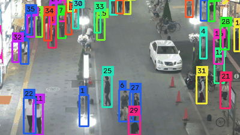
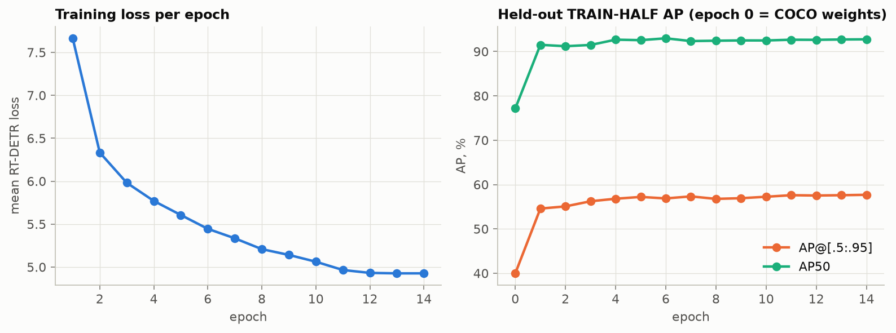
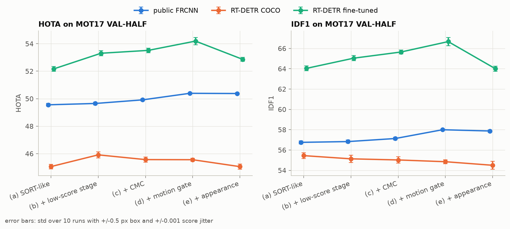
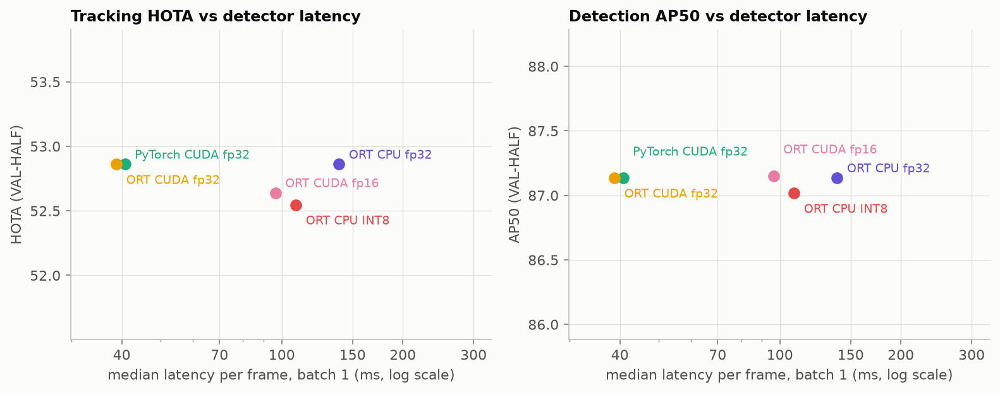

# Трекинг пешеходов на MOT17: RT-DETR, свой трекер и ONNX Runtime

Небольшой исследовательский проект по multi-object tracking. Я дообучил RT-DETR-R18 на пешеходах MOT17, написал с нуля трекер в духе SORT/ByteTrack и по шагам измерил, что даёт каждый его компонент. Отдельно посмотрел, как меняются скорость и качество детектора в ONNX Runtime в fp32, fp16 и INT8 на слабой ноутбучной видеокарте.

Цель была не догнать SOTA, а аккуратно показать, на чём выбирались гиперпараметры, насколько велик разброс, какие компоненты не помогли и почему.



*MOT17-04, первые 10 секунд VAL-HALF, дообученный RT-DETR и трекер, выбранный на train_holdout. Кадры MOT17, лицензия CC BY-NC-SA 3.0.*

## Основные результаты

Все цифры ниже посчитаны на VAL-HALF (вторая половина каждой из 7 обучающих последовательностей MOT17), если не сказано иное. Источник каждой цифры лежит в `results/*.csv`.

1. **Дообучение детектора даёт основной прирост.** RT-DETR-R18 после дообучения: AP 53,0 и AP50 87,1 против 40,7 и 74,8 у весов COCO. HOTA на том же трекере (шаг d) выросла с 45,56 до 54,19; публичные детекции FRCNN дают 50,39.
2. **Детектор заметно запомнил обучающие кадры.** AP дообученной модели: 69,4 на кадрах, на которых она училась, 57,7 на соседних отложенных кадрах и 53,0 на VAL-HALF. У весов COCO и у FRCNN такого разрыва нет (40,1 / 40,0 / 40,7 и 53,3 / 53,8 / 52,2). Поэтому трекер я настраивал только на кадрах, которых детектор не видел.
3. **Гейт по расстоянию Махаланобиса помогает, а признаки внешнего вида нет.** Гейт по фильтру Калмана добавил +0,68 HOTA для дообученного детектора и +0,48 для FRCNN. Признаки zero-shot DINOv2-small поверх гейта дали -1,33, -0,50 и -0,02 HOTA для трёх детекторов.
4. **Выбор конфигурации на маленьком отложенном куске ошибся.** На train_holdout (531 кадр) вариант с признаками внешнего вида выиграл у варианта без него: 63,53 против 63,06 HOTA. На VAL-HALF он проиграл: 52,86 против 54,19. В демо и в замерах деплоя используется именно он, то есть не лучший на VAL-HALF.
5. **Разница между соседними шагами сравнима с разбросом результатов.** Если сдвинуть боксы на ±0,5 px и score на ±0,001, HOTA всего VAL-HALF меняется со стандартным отклонением от 0,02 до 0,27. Разница двух соседних шагов по отдельным последовательностям при этом доходит до ±5 HOTA. Например, компенсация движения камеры (CMC) даёт -4,13 на MOT17-11 и +5,42 на MOT17-13 для FRCNN.
6. **Четверть размеченных пешеходов детектор не учили находить.** 25,6% боксов пешеходов в VAL-HALF имеют видимость меньше 0,25. Я исключил их из обучения и из AP, но TrackEval считает их обычными объектами. По разметке TrackEval AP дообученной модели падает с 53,0 до 43,2, recall50 с 91,3 до 80,9. DetRe трекинга при этом всего 55,12.
7. **Ассоциация не узкое место.** Если подать трекеру боксы разметки вместо детекций, HOTA равна 95,44 (AssA 95,01). Основные потери дают детекции.
8. **Деплой: ORT CUDA fp32 немного быстрее PyTorch, fp16 на этой карте в 2,5 раза медленнее.** Медианная задержка на кадр 960x544: 38,8 мс в ORT CUDA fp32 против 40,7 мс в PyTorch, качество совпадает. В fp16 задержка 96,4 мс, а с перебором алгоритмов cuDNN (`EXHAUSTIVE`) модель выдаёт одни NaN. INT8 на CPU работает за 108,5 мс против 138,9 мс в fp32, HOTA 52,55 против 52,86.

## Протокол

- **Данные.** Только train-часть MOT17: 7 последовательностей, изображения и разметка из копии FRCNN. Тестовый сервер MOTChallenge я не использовал.
- **Разбиение (half split, как в абляциях CenterTrack и ByteTrack).** Кадры `1..N/2` каждой последовательности образуют TRAIN-HALF, остальные VAL-HALF. TRAIN-HALF я делю ещё раз: первые 80% (`train_fit`, 2126 кадров) идут на обучение детектора, последние 20% (`train_holdout`, 531 кадр) на выбор эпохи детектора, настройку порогов трекера и выбор варианта. На VAL-HALF ничего не настраивается.
- **Разметка для обучения и AP.** Класс 1 (pedestrian), `consider == 1`, видимость не меньше 0,25. Менее видимые пешеходы и классы 2, 7, 8, 12 (person on vehicle, static person, distractor, reflection) идут в ignore-регионы COCO (`iscrowd`).
- **Разметка для трекинга.** TrackEval `MotChallenge2DBox` (коммит `12c8791`) на VAL-HALF с перенумерованными кадрами. Позитивы: все пешеходы с `consider == 1`, без фильтра по видимости. Детекции, совпавшие с классами 2, 7, 8, 12 по IoU не меньше 0,5 (один к одному), выкидываются. Это строже, чем ignore-регионы COCO: в них может попасть сколько угодно детекций без штрафа.
- **Шум.** Каждый вариант трекера я прогнал ещё 10 раз с равномерным шумом ±0,5 px на координатах боксов и ±0,001 на score. Шум одинаковый для всех вариантов (парное сравнение), стандартное отклонение по этим прогонам указано рядом с цифрами.

## Детектор

**Вопрос.** Сколько даёт дообучение небольшого RT-DETR на MOT17 по сравнению с весами COCO и публичными детекциями FRCNN?

**Постановка.**
- RT-DETR-R18 (`PekingU/rtdetr_r18vd`, Hugging Face Transformers), один класс person.
- Размер входа выбран по AP на train_holdout с весами COCO: длинная сторона 960 (960x544 для 1920x1080).
- Обучение на `train_fit`: 14 эпох, batch 4, AdamW, lr 1e-4 (backbone 1e-5), warmup 300 шагов, затем косинус, fp32 без AMP. Аугментации: масштаб 0,75 до 1,5 со случайным кадрированием, горизонтальный флип, HSV-jitter.
- Чекпоинт выбирается по AP на `train_holdout`. Лучшей оказалась последняя, 14-я эпоха.
- Порог score 0,05, до 300 детекций на кадр, NMS нет.

Выбор разрешения, веса COCO, train_holdout:

| Вход (1920x1080) | AP | AP50 | мс/кадр | пик памяти, МБ |
|---|---|---|---|---|
| 640x352 | 34,3 | 70,6 | 21,2 | 195 |
| 800x448 | 37,8 | 74,6 | 29,9 | 252 |
| 960x544 | 40,0 | 77,2 | 39,6 | 328 |
| 1088x608 | 38,5 | 76,0 | 51,8 | 392 |
| 1280x704 | 35,8 | 75,6 | 76,3 | 505 |

VAL-HALF. Первые три столбца по разметке с видимостью от 0,25, последние три по разметке TrackEval (все видимости):

| Детектор | AP | AP50 | recall50 | AP, все vis | AP50, все vis | recall50, все vis |
|---|---|---|---|---|---|---|
| public FRCNN | 52,2 | 68,2 | 68,0 | 39,0 | 50,4 | 50,9 |
| RT-DETR-R18, COCO | 40,7 | 74,8 | 83,7 | 31,9 | 60,8 | 71,5 |
| RT-DETR-R18, дообученный | 53,0 | 87,1 | 91,3 | 43,2 | 73,3 | 80,9 |

AP (видимость от 0,25) на разных частях данных:

| Детектор | кадры обучения (train_fit) | train_holdout | VAL-HALF |
|---|---|---|---|
| public FRCNN | 53,3 | 53,8 | 52,2 |
| RT-DETR-R18, COCO | 40,1 | 40,0 | 40,7 |
| RT-DETR-R18, дообученный | 69,4 | 57,7 | 53,0 |



**Что это значит.** Дообучение на 2126 кадрах поднимает AP50 с 74,8 до 87,1. AP почти сравнялся с публичным FRCNN, а AP50 и recall заметно выше. Разрыв 69,4 / 57,7 / 53,0 показывает, что модель частично запомнила сцены. VAL-HALF состоит из тех же сцен и тех же людей, что и обучающие кадры, так что это проверка обобщения внутри последовательности, а не на новые сцены.

**Ограничения.**
- Один запуск обучения с одним seed. Обучение я запускал до того, как включил детерминированные алгоритмы cuDNN, поэтому повторный запуск даст немного другие веса. Разброс по seed я не мерил.
- На каких данных обучен публичный FRCNN, я не проверял. Пересечение с MOT17 train исключить не могу.
- Пешеходы с видимостью ниже 0,25 при обучении считаются фоном. Вариант с `MIN_VISIBILITY = 0` я не пробовал, хотя именно он должен поднять DetRe трекинга.

## Трекер и пошаговое сравнение

**Вопрос.** Что реально дают компоненты, которые обычно добавляют к SORT: второй этап ассоциации по детекциям с низкой уверенностью из ByteTrack, компенсация движения камеры, гейт по фильтру Калмана и признаки внешнего вида (ReID)?

**Постановка.**
- Фильтр Калмана с постоянной скоростью в координатах (cx, cy, a, h) и венгерский алгоритм по IoU с fuse score. Пороги и параметры ассоциации по умолчанию взяты из ByteTrack для MOT17.
- Шаги: (a) один этап ассоциации; (b) плюс второй этап по детекциям с низким score; (c) плюс CMC: аффинное преобразование подобия по разреженному оптическому потоку Лукаса-Канаде и RANSAC на кадрах, уменьшенных вдвое; (d) плюс гейт по расстоянию Махаланобиса (хи-квадрат, 95%, 4 степени свободы) на первом этапе, как в DeepSORT; (e) плюс косинусное расстояние между эмбеддингами DINOv2-small, смешанное со стоимостью по IoU с весом `iou_weight`.
- На train_holdout для каждого детектора настраиваются порог high score (0,3 до 0,7) и `iou_weight` для шага (e) (0,5 до 1,0; при 1,0 шаг e совпадает с d). Там же выбирается вариант, который идёт в демо и деплой.
- Оценка: TrackEval на VAL-HALF, плюс 10 прогонов с шумом для каждого варианта.

HOTA на VAL-HALF (± стандартное отклонение по 10 зашумлённым прогонам), IDF1 и IDSW для дообученного детектора:

| Шаг | public FRCNN | RT-DETR-R18, COCO | RT-DETR-R18, дообученный | IDF1, дообученный | IDSW, дообученный |
|---|---|---|---|---|---|
| (a) SORT-подобный | 49,55 ± 0,09 | 45,06 ± 0,16 | 52,17 ± 0,17 | 64,04 | 209 |
| (b) + второй этап по детекциям с низким score | 49,65 ± 0,10 | 45,91 ± 0,22 | 53,31 ± 0,19 | 65,04 | 195 |
| (c) + CMC | 49,91 ± 0,08 | 45,57 ± 0,19 | 53,51 ± 0,17 | 65,65 | 156 |
| (d) + гейт по Махаланобису | 50,39 ± 0,02 | 45,56 ± 0,11 | 54,19 ± 0,27 | 66,67 | 157 |
| (e) + признаки внешнего вида (DINOv2) | 50,37 ± 0,06 | 45,05 ± 0,18 | 52,86 ± 0,15 | 64,00 | 170 |

По train_holdout выбраны: (e) с `iou_weight` 0,9 для FRCNN, (c) для RT-DETR COCO, (e) с `iou_weight` 0,7 для дообученного RT-DETR.

Изменение HOTA между соседними шагами, в скобках стандартное отклонение этой разницы по парным зашумлённым прогонам:

| Переход | public FRCNN | RT-DETR-R18, COCO | RT-DETR-R18, дообученный |
|---|---|---|---|
| b-a | +0,10 (0,02) | +0,85 (0,20) | +1,14 (0,22) |
| c-b | +0,26 (0,07) | -0,34 (0,17) | +0,21 (0,06) |
| d-c | +0,48 (0,09) | -0,01 (0,14) | +0,68 (0,24) |
| e-d | -0,02 (0,07) | -0,50 (0,26) | -1,33 (0,28) |

Та же разница по последовательностям. MOT17-02, 04 и 09 сняты статичной камерой, 05, 10, 11 и 13 движущейся:

| Детектор | MOT17-02 | MOT17-04 | MOT17-09 | MOT17-05 | MOT17-10 | MOT17-11 | MOT17-13 |
|---|---|---|---|---|---|---|---|
| c-b public FRCNN | +0,05 | +0,00 | -0,97 | +0,98 | +2,17 | -4,13 | +5,42 |
| c-b RT-DETR-R18, COCO | -0,57 | -0,24 | -0,12 | +0,94 | -2,33 | -1,09 | +2,69 |
| c-b RT-DETR-R18, дообученный | +0,03 | -0,01 | +0,47 | +2,76 | -1,53 | +0,40 | +2,61 |
| e-d public FRCNN | -0,08 | -0,01 | +0,00 | -0,24 | +0,09 | -0,01 | -0,01 |
| e-d RT-DETR-R18, COCO | -0,38 | -0,26 | -0,53 | -1,07 | +1,66 | -3,87 | +0,08 |
| e-d RT-DETR-R18, дообученный | -0,89 | -1,04 | -3,43 | -3,04 | +0,29 | -4,54 | -0,06 |



**Что это значит.**
- Второй этап по детекциям с низким score надёжно помогает RT-DETR (+0,85 и +1,14 при шуме около 0,2). У FRCNN детекций с низким score почти нет, и эффект едва заметен.
- CMC в сумме даёт от -0,34 до +0,26, но по сценам картина пёстрая. На статичных камерах сдвиг не больше одного HOTA и объясняется шумом: на MOT17-09 оценённое движение камеры субпиксельное, а знак эффекта меняется от детектора к детектору. На MOT17-11 камера едет вперёд, и модель подобия на 4 параметра для такого движения не подходит: движение точек на изображении зависит от глубины, а пешеходов я при оценке не маскировал. Здесь CMC в моей реализации просто не работает.
- Гейт стабильно помогает при хороших детекциях: +0,48 и +0,68 при шуме 0,09 и 0,24. Гейт не входит в ByteTrack, это моё добавление.
- Признаки DINOv2-small без дообучения на ReID-данных не помогают: у дообученного детектора IDF1 падает с 66,67 до 64,00, а IDSW растёт со 157 до 170. На train_holdout лучшим оказался вес признаков внешнего вида 0,3 (`iou_weight` 0,7), но на VAL-HALF этот вариант хуже.
- Сама логика трекера быстрая: от 448 до 1015 кадров в секунду без детектора в одном потоке CPU. Больше всего времени занимают CMC (15,7 мс на кадр на CPU) и эмбеддинги DINOv2 (75,0 мс на кадр на GPU, в среднем 17,7 кропа на кадр).

**Ограничения.**
- Вывод о шаге, который меньше примерно 0,3 HOTA, на 7 последовательностях делать нельзя. Шум с джиттером боксов оценивает только чувствительность ассоциации к мелким возмущениям, это не bootstrap по сценам.
- train_holdout маленький (531 кадр) и примыкает по времени к кадрам обучения детектора. Для дообученной модели HOTA на нём 63,1, на VAL-HALF 54,2 (шаг d). Выбор варианта на таком куске, как видно по шагу e, ненадёжен. Эпоху детектора я тоже выбирал на train_holdout, так что для дообученной модели это уже не независимая выборка.
- На TRAIN-HALF целиком (80% кадров из обучения детектора) HOTA дообученной модели 64,7 на шаге d. Эти цифры есть в `results/tracking_train_splits.csv` только для иллюстрации, ни для какого выбора они не используются.
- Чувствительность к порогу и max age (`figures/tracking_sensitivity.png`) посчитана на VAL-HALF и нужна только для анализа. Для RT-DETR COCO лучший порог на VAL-HALF 0,4 (46,76 HOTA), а на train_holdout выбран 0,3.

## Деплой детектора: ONNX Runtime, fp16, INT8

**Вопрос.** Как меняются скорость и качество, если запускать дообученный RT-DETR через ONNX Runtime в fp32, в fp16 на GPU и в INT8 на CPU?

**Постановка.**
- Экспорт `torch.onnx` (opset 17) с фиксированным входом. Задержка меряется на 250 случайных кадрах VAL-HALF 960x544, batch 1, после 30 прогревочных прогонов. Время включает копирование на GPU и обратно, но не декодирование JPEG и ресайз.
- GPU свободен (проверка через `nvidia-smi` до и после замеров). CPU-варианты привязаны к 8 ядрам через `sched_setaffinity`, 8 потоков intra-op. Load average до и после каждого замера записан в `results/deploy.csv`.
- fp16: конвертер `onnxruntime.transformers.float16`, 10 типов операций (Softmax, LayerNorm, ReduceMean, Pow, Div и др.) оставлены в fp32, в графе 189 узлов Cast. Поиск алгоритмов cuDNN: `DEFAULT`; с `EXHAUSTIVE` сделан отдельный замер.
- INT8: статическая QDQ-квантизация только Conv, веса per-channel, калибровка по перцентилю 99,99 на 64 кадрах TRAIN-HALF.
- Качество: детекции на всём VAL-HALF и тот же трекер, выбранный на train_holdout (шаг e).

| Вариант | медиана, мс | p90, мс | AP50 | HOTA | IDF1 | размер, МБ |
|---|---|---|---|---|---|---|
| PyTorch, CUDA fp32 | 40,7 | 41,2 | 87,14 | 52,86 | 64,00 | 77,2 |
| ORT, CUDA fp32 | 38,8 | 38,9 | 87,14 | 52,86 | 64,00 | 77,3 |
| ORT, CUDA fp16 | 96,4 | 96,7 | 87,15 | 52,64 | 63,71 | 39,0 |
| ORT, CUDA fp16, EXHAUSTIVE | 156,8 | 156,8 | NaN | NaN | NaN | 39,0 |
| ORT, CPU fp32, 8 потоков | 138,9 | 145,2 | 87,14 | 52,86 | 64,00 | 77,3 |
| ORT, CPU INT8, 8 потоков | 108,5 | 111,2 | 87,02 | 52,55 | 64,30 | 33,3 |



**Что это значит.**
- ORT CUDA fp32 даёт те же детекции, что PyTorch (на 8 проверочных кадрах каждого размера максимальное расхождение боксов меньше 0,001 px), и работает примерно на 5% быстрее.
- fp16 на T1200 (Turing) не окупается: задержка в 2,5 раза выше, чем в fp32. Я предполагаю, что дело в 189 узлах Cast между fp16 и fp32 частями графа, но профилировщиком ORT это не проверял. С `EXHAUSTIVE` fp16-модель выдаёт NaN на всех выходах, поэтому качество для неё не посчитано. Переход на fp16 почти не меняет детекции: на проверочных кадрах совпало 98,6% и 100% детекций для двух размеров входа, боксы разошлись максимум на 1,18 px.
- INT8 на CPU на 22% быстрее fp32, а модель вдвое меньше. HOTA ниже на 0,31, что сравнимо с шумом трекера (0,15 для этой конфигурации). Отдельные боксы сдвигаются сильнее: совпало 97,9% и 98,2% детекций, максимальное расхождение 31,2 px на входе 960x704.

**Ограничения.**
- Одна видеокарта (T1200, 4 ГБ), batch 1, один размер входа для замеров. TensorRT я не пробовал.
- CPU-замеры сделаны на общей машине. Load average во время замеров поднимался с 1,7 до 6,1, в основном из-за самих 8 потоков, но фоновую нагрузку полностью я не исключал.
- Проверка совпадения выходов сделана на 8 кадрах для каждого размера входа.

## Как воспроизвести

Железо: ноутбучная NVIDIA T1200 на 4 ГБ, драйвер 535 (CUDA 12.2), 16 ядер CPU, 62 ГБ RAM. Python 3.12, torch 2.7.1 со сборкой под CUDA 12.6 с PyPI, она работает с драйвером 535.

```bash
git clone <этот репозиторий> && cd mot-tracking-study
./run_all.sh            # полный прогон на GPU
ALLOW_CPU=1 ./run_all.sh  # без GPU: только публичные детекции FRCNN, результаты в results/cpu_subset
```

`run_all.sh` сам создаёт venv, ставит зависимости из `requirements.lock`, скачивает MOT17 (около 6 ГБ) и клонирует TrackEval на зафиксированном коммите. Отдельные шаги:

```bash
.venv/bin/python -m pytest -q                         # тесты на синтетике, около 2 с
.venv/bin/python -m mts.data                          # кэш публичных детекций, статистика разбиения
.venv/bin/python -m mts.evaluate build-gt             # разметка половин для TrackEval
.venv/bin/python -m mts.detect resolution             # выбор размера входа
.venv/bin/python -m mts.detect cache --source rtdetr_coco
.venv/bin/python -m mts.train_detector                # дообучение, 91 мин
.venv/bin/python -m mts.detect cache --source rtdetr_ft
.venv/bin/python -m mts.detect eval                   # AP, около 2,5 мин
.venv/bin/python -m mts.tracker.cmc                   # кэш движения камеры
.venv/bin/python -m mts.tracker.reid --sources rtdetr_ft public_frcnn rtdetr_coco --device cuda
.venv/bin/python -m mts.exp_tracking --workers 8      # настройка, лестница, шум, чувствительность: около 7 мин
.venv/bin/python -m mts.exp_tracking --oracle         # трекинг по боксам разметки
.venv/bin/python -m mts.demo                          # figures/demo.gif
.venv/bin/python -m mts.deploy.export --check-frames 8 --calib-frames 64
.venv/bin/python -m mts.deploy.bench                  # задержка и качество, около 4,5 мин
```

Время указано по моему последнему прогону. Кэширование эмбеддингов DINOv2 для трёх детекторов заняло около 20 минут на GPU. Веса RT-DETR и DINOv2 скачиваются с Hugging Face по зафиксированным ревизиям. Трекинг детерминирован при фиксированных входах; обучение детектора на GPU побитово не воспроизводится.

## Структура репозитория

```
src/mts/
  data.py             последовательности, разбиение на половины, разметка, кэш детекций
  evaluate.py         запись в формате MOT, вызов TrackEval, проверки оценщика
  detector.py         обёртка RT-DETR, пред- и постобработка
  train_detector.py   дообучение на train_fit, выбор эпохи на train_holdout
  detect.py           кэширование детекций, AP по двум определениям разметки, выбор разрешения
  tracker/
    kalman.py         фильтр Калмана и расстояние Махаланобиса
    matching.py       IoU, стоимости, венгерский алгоритм
    cmc.py            компенсация движения камеры
    reid.py           эмбеддинги DINOv2-small для кропов
    tracker.py        трекер и варианты (a)-(e)
  exp_tracking.py     настройка на train_holdout, лестница, шум, чувствительность, оракул
  demo.py             GIF
  deploy/export.py    экспорт ONNX, fp16, INT8, сверка выходов
  deploy/bench.py     задержка и качество вариантов
  plotting.py         общий стиль графиков
tests/                pytest на синтетических данных, без GPU и датасета
results/              все таблицы в длинном формате (CSV) и выбранные конфигурации (JSON)
figures/              графики и демо
run_all.sh            полный прогон
```

Основные таблицы: `detection.csv`, `gt_visibility.csv`, `detector_training.csv`, `detector_resolution.csv`, `tracking.csv` (VAL-HALF), `tracking_steps_val_half.csv` (разницы шагов и шум), `tracking_noise_val_half.csv`, `tracking_tuning_train_holdout.csv`, `tracking_train_splits.csv`, `tracking_best.json`, `deploy.csv`, `deploy_agreement.csv`.

## Ограничения и что дальше

- Всё измерено на half split обучающей части MOT17: 7 последовательностей, проверка внутри тех же сцен и тех же людей. Сабмита на тестовый сервер MOTChallenge нет, и сравнивать эти цифры с таблицей лидеров напрямую нельзя.
- Цифры заметно ниже SOTA. Сильные трекеры на MOT17 используют детекторы в разы крупнее R18, обучают их на CrowdHuman и других данных о пешеходах, берут вход больше 960x544 и не выкидывают плохо видимых людей из обучения. Оракул с HOTA 95,44 показывает, что основной резерв в детекторе, а не в ассоциации.
- Детектор обучен один раз с одним seed. Трекинг оценён по 10 зашумлённым прогонам, но это не заменяет разброс по сценам и по seed обучения.
- Что попробовал бы дальше: обучить детектор с пешеходами любой видимости и сравнить DetRe; маскировать пешеходов при оценке CMC и откатываться к единичному преобразованию при малой доле инлаеров; заменить zero-shot DINOv2 на ReID-модель, обученную на пешеходах; выбирать конфигурацию кросс-валидацией по последовательностям вместо одного короткого куска; профилировать fp16-граф и попробовать TensorRT.

## Лицензии и ссылки

Код распространяется по лицензии MIT, см. `LICENSE`.

- **MOT17**, CC BY-NC-SA 3.0. Кадры в `figures/demo.gif` взяты из MOT17 и распространяются на тех же условиях. A. Milan, L. Leal-Taixé, I. Reid, S. Roth, K. Schindler. MOT16: A Benchmark for Multi-Object Tracking. arXiv:1603.00831, 2016.
- **RT-DETR**, Apache 2.0, веса `PekingU/rtdetr_r18vd`. Y. Zhao, W. Lv, S. Xu, J. Wei, G. Wang, Q. Dang, Y. Liu, J. Chen. DETRs Beat YOLOs on Real-time Object Detection. CVPR 2024.
- **DINOv2**, Apache 2.0, веса `facebook/dinov2-small`. M. Oquab et al. DINOv2: Learning Robust Visual Features without Supervision. TMLR 2024.
- **TrackEval**, MIT. J. Luiten, A. Hoffhues. TrackEval, 2020. J. Luiten et al. HOTA: A Higher Order Metric for Evaluating Multi-Object Tracking. IJCV 2021.
- **ByteTrack**: Y. Zhang et al. ByteTrack: Multi-Object Tracking by Associating Every Detection Box. ECCV 2022.
- **SORT**: A. Bewley, Z. Ge, L. Ott, F. Ramos, B. Upcroft. Simple Online and Realtime Tracking. ICIP 2016.
- **DeepSORT** (гейт по Махаланобису): N. Wojke, A. Bewley, D. Paulus. Simple Online and Realtime Tracking with a Deep Association Metric. ICIP 2017.
- **BoT-SORT** (идея CMC по оптическому потоку): N. Aharon, R. Orfaig, B.-Z. Bobrovsky. BoT-SORT: Robust Associations Multi-Pedestrian Tracking. arXiv:2206.14651, 2022.
